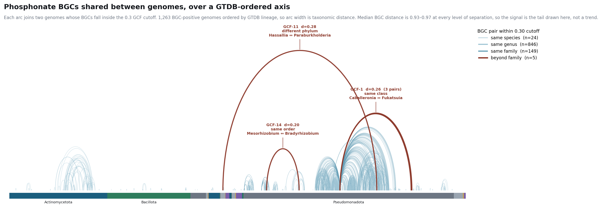

# Horizontally transferred phosphonate BGCs: candidates, and the ablation behind them

Measured 2026-10-24/25 on the whole-Bacteria reference pilot (4,193 retained
genomes, 1,345 regions, 1,020 GCF families) and the GenBank Enterobacterales run
(1,530 retained, 1,476 regions). The summary lives in CLAUDE.md under
"Horizontal transfer"; this directory holds the scripts and the data.

## Why there is no scatter plot

The obvious figure — BGC similarity against taxonomic distance — shows nothing.
Median BiG-SCAPE distance is **0.93–0.97 at every level of separation**, same
species through different phylum. There is no trend to fit, which is the same
conclusion that retired the Yu et al. replication, reached independently.

| separation | pairs | median d | min d | within 0.30 cutoff |
|---|---:|---:|---:|---:|
| same species | 133 | 0.952 | 0.000 | 24 |
| same genus | 18,437 | 0.932 | 0.000 | 846 |
| same family | 35,201 | 0.942 | 0.041 | 149 |
| same order | 17,612 | 0.963 | 0.204 | **1** |
| same class | 93,777 | 0.969 | 0.261 | **3** |
| same phylum | 107,458 | 0.969 | 0.340 | 0 |
| different phylum | 631,222 | 0.971 | 0.282 | **1** |

All 903,840 pairs — the complete `distance` table, `n(n-1)/2` exactly.

The signal is the tail, so `hgt_arcs.py` draws the tail over a backbone that
makes distance legible: genomes on a GTDB-ordered axis, one arc per pair inside
the cutoff. Local sharing piles into dense bands inside Actinomycetota and
Pseudomonadota; the long-range arcs leap clear. Every within-cutoff pair is on
the plot, so the exceptions are visible **against** the rule rather than
extracted from it.



## The candidates

| GCF | d | separation | organisms |
|---|---:|---|---|
| GCF-14 | 0.204 | same order | *Mesorhizobium metallidurans* / *Bradyrhizobium oropedii* |
| GCF-1 | 0.261–0.262 | same class, 3 pairs | *Ca.* Burkholderia verschuerenii / *Ca.* Fukatsuia spp. |
| GCF-11 | 0.282 | **different phylum** | *Hassallia byssoidea* (Cyanobacteriota) / *Paraburkholderia phenazinium* |

The GCF-1 carriers are both insect endosymbionts — a shared niche is the
textbook setting for transfer. GCF-11 crosses a phylum boundary.

## The asymmetry that makes any of this quotable

**"Crosses a genus boundary" survives ablation. "Is confined to one genus" does
not.**

`ablate_pos.py` trims every region to `proto_core` ± 2 kb — 49% of CDS removed,
median region 28 kb → 13 kb — and re-clusters. `compare_ablation.py` compares
three clusterings: the pipeline's, a **matched control** re-clustering the
untrimmed regions, and the trimmed arm. The control is not optional: BiG-SCAPE
does not reproduce itself exactly, and it establishes the noise floor.

| | pipeline | control | trimmed |
|---|---:|---:|---:|
| families | 1,020 | 1,020 | 755 |
| multi-member | 85 | 85 | 132 |
| crossing a genus boundary | 8 (9.4%) | 8 (9.4%) | **51 (38.6%)** |
| co-membership Jaccard vs control | 0.9945 | — | **0.2590** |

So the noise floor is tiny (6 split / 23 merged between identical runs) and the
trim's effect is enormous. Most apparent genus-confinement is BiG-SCAPE reading
the 10 kb neighbourhood's shared housekeeping — the same thing the pantaphos
186/29 split turned out to be.

**But all 8 cross-genus GCFs still cross one after trimming**, which is why the
positive claim holds and the negative one does not. `gcf_taxonomy.tsv` carries
the per-family detail, including a `robust_cross_genus` column.

The trimmed clustering is **not** "the right answer" either: 2,626 pairs split
as well as 5,022 merged, and the trim discards real tailoring chemistry — bare
`proto_core` drops LeuC/LeuD, the methyltransferase, SanS and the GNAT from the
pantaphos cluster. The full-region clustering over-splits on context; the
trimmed one plausibly over-merges. The honest statement is the asymmetry, not
either number.

## Pantaphos

Composition says acquired. Pantaphos regions sit **9.8 GC points below their
host genomes** — 43.83% against 53.60%, median −10.33, sd **1.37** across 235
regions. The control is what makes that mean something: other phosphonate
regions across Enterobacterales sit at **−0.60 pp** (median +0.87, sd 4.36), so
low GC is not a property of phosphonate BGCs.

Distribution fits one ancient acquisition followed by vertical inheritance. All
235 within-cutoff hits are *Pantoea* — the lone "uncultured" is *uncultured
Pantoea sp.* — spread over *ananatis* 180, *agglomerans* 32, *allii* 13, sp. 8,
*vagans* 1, while ***P. stewartii* carries 9 phosphonate regions and none
pantaphos-like**. The nearest non-*Pantoea* relatives are all insect-associated:
*Ca.* Stammera capleta (a beetle endosymbiont) at **0.303**, just outside the
cutoff, then *Photorhabdus* (42 regions at 0.30–0.70) and *Xenorhabdus* (17).

**The caveat that stops this being clean.** *P. ananatis* carries a second,
unrelated phosphonate cluster — d ≈ 0.96 from pantaphos, 35.5 kb, on a different
contig, conserved to the base pair across strains — with **the same −10.2 pp
anomaly**. Within *Pantoea* the signature does not single pantaphos out. Either
the lineage acquired two phosphonate islands independently, or something else
about its phosphonate loci is compositionally atypical.

**What would settle it**, all cheap and all on disk: codon-usage bias against
the host, which is stronger evidence than GC alone, and mobility markers at the
island boundaries (integrases, tRNA insertion sites, direct repeats). Two
insertions each beside a tRNA with integrase remnants would make the case.

## Limits to carry with any of these numbers

- **An arc is co-membership, not transfer.** Low distance between distant
  organisms is consistent with HGT and equally with convergent retention or an
  ancient origin plus heavy loss.
- **The two instruments see different things.** Pantaphos is *invisible* on the
  arc figure, because it never crosses a genus boundary; composition catches
  transfers old enough for the recipient lineage to have diversified. Neither
  method alone is a survey.
- **0.30 is the GCF clustering cutoff, not an HGT threshold.** At 0.50 the
  beyond-family count goes from 5 to 56.
- **One genome per species.** Within-species spread is invisible by
  construction, and 938 of the 1,022 families are singletons for that reason.

## Reproducing

```bash
python ablate_pos.py <outdir> 2            # builds control/ and trim2kb/
bigscape cluster -i <outdir>/control  -o <outdir>/out_control  --pfam-path ... \
    --alignment-mode auto --gcf-cutoffs 0.30 --include-singletons --classify category
bigscape cluster -i <outdir>/trim2kb  -o <outdir>/out_trim2kb  ...same flags...
python compare_ablation.py
python hgt_arcs.py
```

`export PYTHONHASHSEED=0` for every BiG-SCAPE call, or the distances are not
reproducible — see the note in CLAUDE.md.
